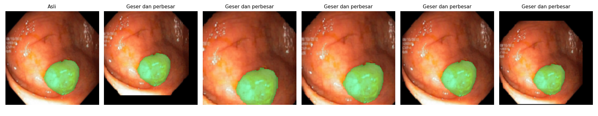
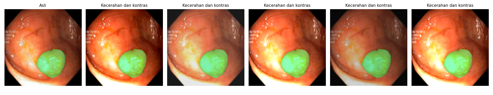
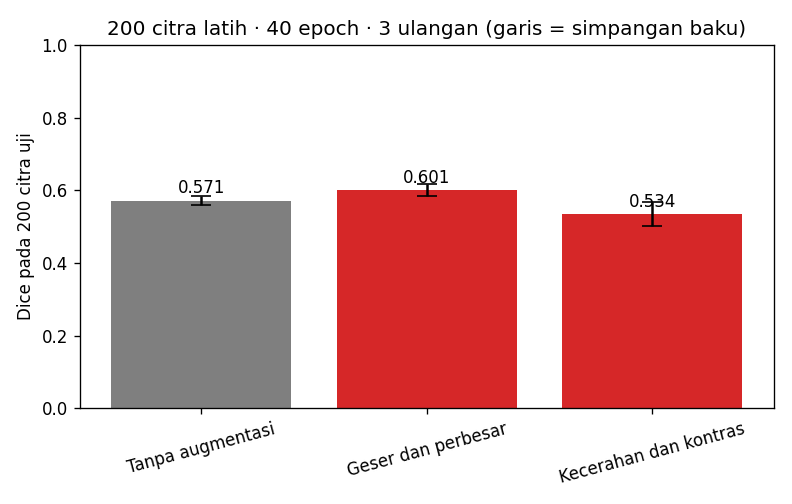
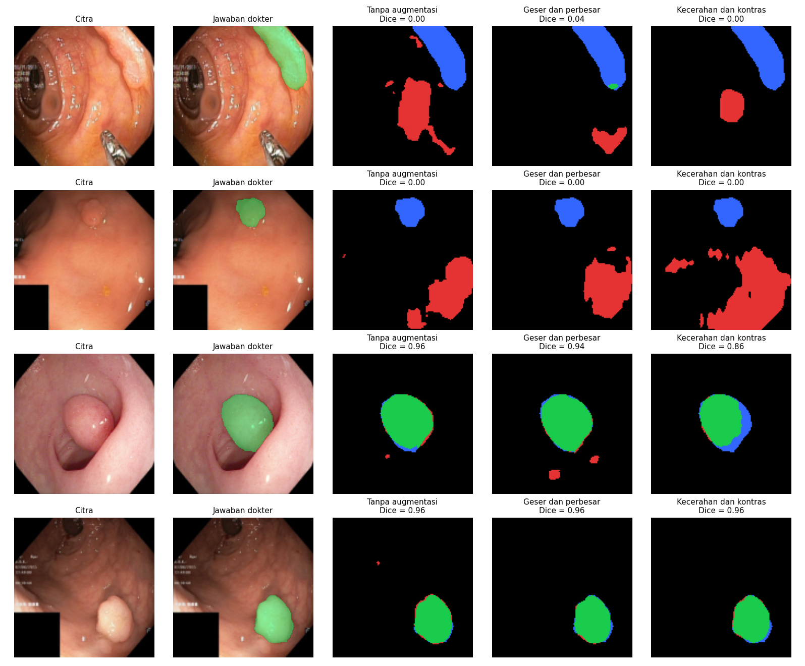

# Segmentasi Polip pada Citra Kolonoskopi dengan U-Net
**Tugas P10 — Kecerdasan Buatan (BM25-41204), Teknik Biomedis ITERA**

## Anggota kelompok

| Nama | NIM | Username GitHub | Kontribusi utama |
|---|---|---|---|
| Fitriah Ramadhani Aulia Rasyidin | 123430045 | FitriahRamahaniAuliaRasyidin | PJ teknis dan eksperimen U-Net |
| Tasya Adinda Putri | 123430129 | TasyaAdindaPutri | Rancangan augmentasi dan analisis kesalahan |
| Mailani Anatasya | 123430048 | Mailani Anatasya | Evaluasi, pembahasan, dan dokumentasi |

## 1. Pertanyaan

Augmentasi apa yang membantu U-Net menemukan polip pada citra kolonoskopi, dan augmentasi apa yang tidak? Kenapa?

## 2. Data & pengaturan

<!-- Isi dari Bagian 2 notebook. Pastikan CEPAT = False untuk hasil akhir. -->

- Dataset: Kvasir-SEG (1000 citra kolonoskopi + mask polip),
  diperkecil ke 128 × 128 piksel.
- Data uji: 200 citra. Data latih: 200 citra per ulangan.
- Model: U-Net mini (±0,5 juta parameter),
  40 epoch, 3 ulangan per skenario.
- Dijalankan di: Google Colab T4.

## 3. Skenario augmentasi & hipotesis

<!-- Tulis bagian ini SEBELUM menjalankan eksperimen. Commit dulu, baru jalankan.
     Alasan klinis = kenapa variasi ini mungkin (atau tidak mungkin) terjadi pada kolonoskopi sungguhan. -->

| Skenario | Augmentasi (kode) | Alasan klinis | Hipotesis: Dice naik/turun/sama? |
|---|---|---|---|
| Tanpa augmentasi | — | Digunakan sebagai skenario pembanding untuk mengetahui performa dasar U-Net tanpa penambahan variasi citra melalui augmentasi | — |
| Geser dan perbesar | v2.RandomAffine(degrees=0, translate=(0.1, 0.1), scale=(0.8, 1.2)) | Selama pemeriksaan kolonoskopi, perubahan posisi dan jarak pandang kamera endoskop dapat menyebabkan polip terlihat pada posisi dan ukuran yang berbeda. Augmentasi ini digunakan untuk menyimulasikan variasi posisi dan skala objek pada citra | Naik. Model diharapkan lebih mampu mengenali polip pada berbagai posisi dan ukuran tampak |
| Kecerahan dan kontras | v2.ColorJitter(brightness=0.3, contrast=0.3) | Variasi pencahayaan, eksposur kamera, dan pantulan cahaya pada permukaan mukosa dapat menyebabkan perbedaan kecerahan dan kontras citra kolonoskopi. Augmentasi ini digunakan untuk menyimulasikan variasi intensitas visual tersebut | Naik. Model diharapkan lebih mampu melakukan segmentasi polip pada citra dengan kondisi pencahayaan yang bervariasi |

Augmentasi yang dicoba:




**Pertimbangan terhadap keterbatasan augmentasi**

Pada augmentasi geser dan perbesar, perubahan posisi dan skala dapat menyebabkan sebagian area polip terpotong atau munculnya area kosong pada tepi citra. Oleh karena itu, hasil transformasi perlu diperiksa agar bentuk polip tetap masuk akal dan mask tetap sesuai dengan lokasi polip. Pada augmentasi kecerahan dan kontras, perubahan intensitas yang terlalu besar juga berpotensi mengurangi informasi visual yang diperlukan untuk mengenali batas polip.

## 4. Hasil

| Skenario | Dice (rata-rata ± sb) | IoU (rata-rata ± sb) | Dice tiap ulangan |
|---|---|---|---|
| Tanpa augmentasi | 0.571 ± 0.012 | 0.462 ± 0.007 | 0.588, 0.559, 0.566 |
| Geser dan perbesar | 0.601 ± 0.017 | 0.480 ± 0.019 | 0.625, 0.591, 0.587 |
| Kecerahan dan kontras | 0.534 ± 0.033 | 0.419 ± 0.035 | 0.542, 0.490, 0.570 |




## 5. Analisis peta kesalahan

**5.1 Visualisasi**



Pada peta kesalahan, warna hijau menunjukkan *true positive* (polip dikenali dengan benar), merah menunjukkan *false positive* (area bukan polip diprediksi sebagai polip), biru menunjukkan *false negative* (bagian polip tidak terdeteksi), dan hitam menunjukkan *true negative* (area bukan polip dikenali dengan benar)

Empat citra uji dipilih berdasarkan hasil model tanpa augmentasi: dua citra tersulit (baris 1 dan 2, Dice 0,00) dan dua citra termudah (baris 3 dan 4, Dice 0,96). Keempat citra yang sama dipakai untuk membandingkan semua skenario

**5.2 Analisis hasil segmentasi**

**Citra sulit (baris 1 dan 2).** Ketiga skenario gagal mengenali polip pada kedua citra ini (Dice 0,00 sampai 0,04). Kesalahannya berupa salah lokasi: polip sebenarnya tidak terdeteksi (biru), sementara area lain diprediksi sebagai polip (merah). Pada baris 1, geser dan perbesar hanya menangkap sebagian kecil ujung polip (Dice 0,04). Pada baris 2, area *false positive* paling luas dan tersebar muncul pada skenario kecerahan dan kontras

**Citra mudah (baris 3 dan 4).** Ketiga skenario menghasilkan segmentasi yang mirip (Dice 0,86 sampai 0,96)
- Pada baris 3, kecerahan dan kontras melewatkan sebagian tepi kanan polip (*false negative*, Dice 0,86). Geser dan perbesar (0,94) sedikit di bawah tanpa augmentasi (0,96) dan memiliki beberapa bintik *false positive* kecil di luar polip
- Pada baris 4, ketiga skenario menghasilkan bentuk yang hampir sama (Dice 0,96). Hanya skenario tanpa augmentasi yang memiliki bintik *false positive* kecil di luar polip

**Keterbatasan.** Visualisasi hanya memuat empat citra yang dipilih berdasarkan kesulitan bagi model tanpa augmentasi, sehingga bersifat ilustratif dan tidak mewakili seluruh 200 citra uji. Peta kesalahan juga menampilkan satu model per skenario, bukan rata-rata tiga ulangan seperti pada tabel Dice dan IoU. Keunggulan geser dan perbesar pada rata-rata Dice (0,601 dibanding 0,571) tidak terlihat jelas pada keempat citra ini. Selisih antarskenario juga masih berada dalam rentang variasi tiga ulangan, sehingga belum cukup untuk menyatakan perbedaan yang signifikan secara statistik

**5.3 Pertanyaan pemandu**

**Polip seperti apa yang terlewat?** Pada dua citra sulit, polip memiliki warna yang sangat mirip dengan mukosa di sekitarnya. Polip pada baris 1 berbentuk memanjang dan pucat, serta terpotong di tepi citra. Polip pada baris 2 berukuran kecil, bulat, dan pucat, dengan kontras rendah terhadap dinding usus. Sebaliknya, polip pada citra mudah berukuran besar dan menonjol (baris 3), atau jelas lebih terang daripada latarnya (baris 4), sehingga batasnya mudah dibedakan. Pola ini hanya diamati pada empat citra dan perlu dipandang sebagai dugaan, bukan kesimpulan umum

**Apa yang sering dikira polip padahal bukan?** Pada citra sulit, area *false positive* (merah) berada di bagian mukosa biasa tanpa batas yang jelas, terutama pada baris 2, dan paling luas pada skenario kecerahan dan kontras. Pada baris 1, area merah skenario geser dan perbesar berada di dekat posisi alat endoskopi di bagian kanan bawah citra. Kemungkinan ini perlu dipastikan dengan membandingkan langsung dengan citra asli. Pada citra mudah, *false positive* hanya berupa bintik kecil di luar polip

**Apakah augmentasi memperbaiki kasus sulit?** Tidak. Pada kedua citra sulit, ketiga skenario tetap gagal (Dice 0,00 sampai 0,04). Skenario geser dan perbesar hanya menangkap sebagian kecil ujung polip pada baris 1 (Dice 0,04), yang belum dapat dianggap perbaikan berarti. Perlu dicatat bahwa kedua citra sulit dipilih berdasarkan hasil model tanpa augmentasi, sehingga perbandingannya tidak sepenuhnya setara dan hanya bersifat ilustratif

**5.4 Cara Pemilihan Citra dan Keterbatasan Analisis**

Peta kesalahan menampilkan empat citra uji yang terdiri dari dua citra dengan hasil segmentasi paling sulit dan dua citra dengan hasil segmentasi paling mudah berdasarkan nilai Dice pada skenario tanpa augmentasi. Keempat citra tersebut digunakan untuk membandingkan hasil prediksi dari seluruh skenario augmentasi pada gambar yang sama

Visualisasi menggunakan warna hijau untuk *true positive*, merah untuk *false positive*, biru untuk *false negative*, dan hitam untuk *true negative*. Dengan demikian, perbandingan warna dapat membantu mengidentifikasi bagian polip yang berhasil dikenali, bagian yang terlewat, serta area bukan polip yang salah diprediksi

**Keterbatasan analisis:**

Peta kesalahan dibuat menggunakan model dari pengulangan pertama untuk setiap skenario, bukan gabungan hasil dari seluruh pengulangan. Oleh karena itu, peta kesalahan digunakan sebagai contoh analisis visual secara kualitatif dan tidak sepenuhnya mewakili performa rata-rata ketiga pengulangan. Untuk menilai performa keseluruhan, hasil peta kesalahan perlu dibaca bersama nilai rata-rata dan simpangan baku Dice Score serta IoU dari tiga pengulangan

## 6. Pembahasan & kesimpulan

<!-- Bandingkan hasil dengan hipotesis di Bagian 3. Hipotesis yang ternyata salah tetap bernilai,
     asalkan dijelaskan kenapa. Perbedaan kecil (lebih kecil dari simpangan baku) belum tentu berarti. -->

Hasil eksperimen sebagian mendukung hipotesis awal. Skenario geser dan perbesar menghasilkan rata-rata Dice tertinggi, yaitu 0,601 ± 0,017, dibandingkan baseline tanpa augmentasi sebesar 0,571 ± 0,012. Hasil ini menunjukkan bahwa variasi posisi dan skala dapat membantu model mengenali polip dalam kondisi tampilan yang berbeda.

Temuan tersebut sejalan dengan penelitian pada segmentasi polip yang menggunakan transformasi geometris, seperti translasi dan perubahan skala, untuk menyimulasikan pergerakan kamera serta variasi sudut pandang selama kolonoskopi. Variasi skala dan posisi memang menjadi salah satu faktor yang perlu diperhatikan dalam pengembangan model segmentasi citra kolonoskopi.

Sebaliknya, hipotesis bahwa augmentasi kecerahan dan kontras akan meningkatkan performa tidak didukung oleh hasil eksperimen. Skenario ini menghasilkan rata-rata Dice sebesar 0,534 ± 0,033, lebih rendah daripada baseline. Hal ini menunjukkan bahwa penambahan variasi kecerahan dan kontras dengan parameter yang digunakan belum memberikan manfaat pada konfigurasi eksperimen ini. Meskipun augmentasi fotometrik, seperti perubahan brightness dan contrast, umum digunakan dalam segmentasi polip, pengaruhnya dapat bergantung pada karakteristik dataset dan parameter augmentasi yang digunakan.

Analisis peta kesalahan menunjukkan bahwa ketiga skenario masih mengalami kesulitan pada dua citra dengan polip yang memiliki kontras rendah atau karakteristik visual yang sulit dibedakan dari mukosa di sekitarnya. Pada kedua citra tersebut, nilai Dice berada pada rentang 0,00 sampai 0,04. Sebaliknya, pada citra dengan polip yang lebih jelas, ketiga skenario menghasilkan Dice yang tinggi, yaitu 0,86 sampai 0,96.

Secara keseluruhan, geser dan perbesar menjadi skenario terbaik dalam eksperimen ini berdasarkan rata-rata Dice dan IoU. Namun, peningkatan Dice dibandingkan baseline relatif kecil. Dengan hanya tiga ulangan, hasil ini belum cukup untuk menyatakan bahwa perbedaan tersebut signifikan secara statistik. Eksperimen selanjutnya dapat menggunakan lebih banyak ulangan dan variasi parameter augmentasi untuk menguji konsistensi hasil.

## 7. Pembagian kerja

<!-- Siapa mengerjakan apa. Penilaian proses kerja dilihat dari riwayat commit tiap anggota. -->

| Anggota | Kontribusi utama |
|---|---|
| Fitriah Ramadhani Aulia Rasyidin | PJ teknis dan eksperimen U-Net. Menyiapkan dan mengatur notebook, menjalankan eksperimen pada setiap skenario, serta menyimpan hasil eksperimen ke repository. |
| Tasya Adinda Putri | Menyusun rancangan skenario augmentasi dan hipotesis, serta melakukan analisis peta kesalahan hasil segmentasi. |
| Mailani Anatasya | Melakukan evaluasi hasil eksperimen, menyusun pembahasan dan kesimpulan, serta melengkapi dokumentasi dan README. |

## 8. Penggunaan AI

<!-- Wajib diisi, walau tidak memakai AI (tulis "Tidak memakai AI").
     Contoh: "Claude Code (CLI) untuk menulis skenario augmentasi dan memperbaiki error di Bagian 4.
     Draf Bagian 6 ditulis sendiri, lalu dirapikan bahasanya dengan bantuan AI." -->

ChatGPT digunakan untuk membantu merapikan struktur bahasa dan menyusun pembahasan hasil eksperimen berdasarkan tabel metrik, grafik perbandingan, dan peta kesalahan yang dihasilkan notebook. Analisis angka, interpretasi hasil, dan isi akhir README ditinjau kembali oleh anggota kelompok dan disesuaikan dengan hasil eksperimen yang sebenarnya.

## Cara menjalankan ulang

```bash
uv sync
uv run jupyter lab segmentasi_polip.ipynb
```

Atau buka notebook di Google Colab (Runtime → Change runtime type → T4 GPU).

## Referensi

- Cai, T., Yan, H., Ding, K., Zhang, Y. and Zhou, Y. (2024) ‘WSPolyp-SAM: Weakly supervised and self-guided fine-tuning of SAM for colonoscopy polyp segmentation’, Applied Sciences, 14(12), p. 5007. Available at: https://doi.org/10.3390/app14125007.
- Jha, D., Smedsrud, P.H., Riegler, M.A., Halvorsen, P., de Lange, T., Johansen, D. and Johansen, H.D. (2020) ‘Kvasir-SEG: A segmented polyp dataset’, in MultiMedia Modeling. Cham: Springer, pp. 451–462.
- Ouria, M., Asgharzadeh-Bonab, A., Kalbkhani, H. and Rezaei, V. (2026) ‘SegFormer-based boundary-aware polyp segmentation with adaptive multi-branch fusion’, Scientific Reports, 16, Article 20012. Available at: https://doi.org/10.1038/s41598-026-42381-7.
- Ronneberger, O., Fischer, P. and Brox, T. (2015) ‘U-Net: Convolutional networks for biomedical image segmentation’, in Medical Image Computing and Computer-Assisted Intervention (MICCAI). Available at: https://arxiv.org/abs/1505.04597.
- Sánchez-Peralta, L.F., Picón, A., Sánchez-Margallo, F.M. and Pagador, J.B. (2020) ‘Unravelling the effect of data augmentation transformations in polyp segmentation’, International Journal of Computer Assisted Radiology and Surgery, 15, pp. 1975–1988. Available at: https://doi.org/10.1007/s11548-020-02262-4.
